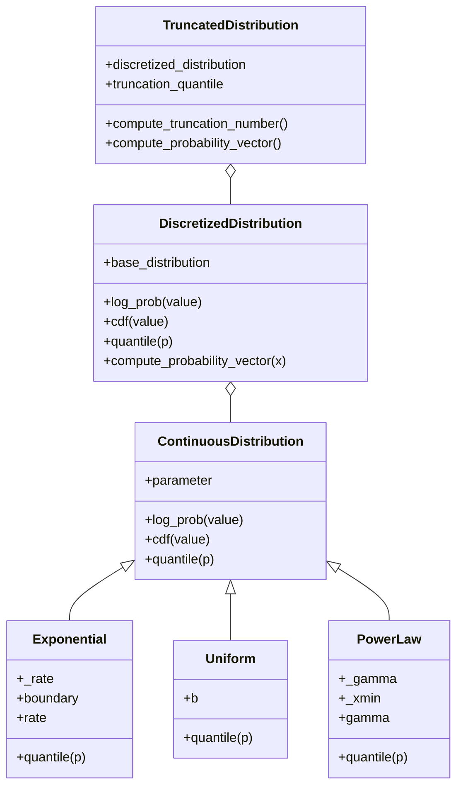

# Adaptive Width Neural Networks (AWN) — Full Technical Documentation

Official codebase documentation for **Adaptive Width Neural Networks (AWN)**, an architecture-learning framework presented at **ICLR 2026** by Federico Errica, Henrik Christiansen, Viktor Zaverkin, Mathias Niepert, and Francesco Alesiani (NEC Laboratories Europe GmbH & University of Stuttgart).

---

## Table of Contents

1. [Executive Summary](#1-executive-summary)
2. [Theoretical & Mathematical Foundations](#2-theoretical--mathematical-foundations)
   - [2.1 Variational Formulation & ELBO](#21-variational-formulation--elbo)
   - [2.2 Width Probability Distributions](#22-width-probability-distributions)
   - [2.3 Discretization & Truncation Mechanism](#23-discretization--truncation-mechanism)
   - [2.4 Activation Scaling / Importance Gating](#24-activation-scaling--importance-gating)
   - [2.5 Annealing Strategy](#25-annealing-strategy)
3. [System Architecture & File Organization](#3-system-architecture--file-organization)
4. [Core Modules Detailed Reference](#4-core-modules-detailed-reference)
   - [4.1 `model.py`](#41-modelpy)
   - [4.2 `dynamic_architecture.py`](#42-dynamic_architecturepy)
   - [4.3 `distribution.py`](#43-distributionpy)
   - [4.4 `dynamic_optimizers.py`](#44-dynamic_optimizerspy)
   - [4.5 `dynamic_transformer.py` & `transformer_util/`](#45-dynamic_transformerpy--transformer_util)
   - [4.6 `metric.py`](#46-metricpy)
   - [4.7 `scheduler.py`](#47-schedulerpy)
   - [4.8 `experiment.py`](#48-experimentpy)
   - [4.9 `dataset.py` & `transform.py`](#49-datasetpy--transformpy)
   - [4.10 `plotter.py`](#410-plotterpy)
5. [Supported Model Families & Modalities](#5-supported-model-families--modalities)
6. [Experiment Configuration System (MLWiz)](#6-experiment-configuration-system-mlwiz)
   - [6.1 Data Configuration Structure](#61-data-configuration-structure)
   - [6.2 Experiment Configuration Structure](#62-experiment-configuration-structure)
   - [6.3 Search Baselines (Local Search & BayesOpt)](#63-search-baselines-local-search--bayesopt)
7. [Installation, Setup & Usage Guide](#7-installation-setup--usage-guide)
   - [7.1 Environment Installation](#71-environment-installation)
   - [7.2 Data Preparation Workflow](#72-data-preparation-workflow)
   - [7.3 Running AWN vs. Baselines](#73-running-awn-vs-baselines)
   - [7.4 Benchmarks and Unit Tests](#74-benchmarks-and-unit-tests)
8. [Developer Guide: Extending AWN](#8-developer-guide-extending-awn)

---

## 1. Executive Summary

Standard deep neural networks treat the width (number of neurons, filters, or hidden dimensions) as an immutable hyperparameter that must be manually tuned, discovered via costly Neural Architecture Search (NAS), or pruned post-hoc. 

**Adaptive Width Neural Networks (AWN)** introduces an end-to-end framework where **width is treated as a dynamic random variable** whose probability distribution is optimized jointly with network weights via stochastic gradient descent:

- **Joint Optimization**: Layer weights $\theta$ and width parameters $\alpha$ (e.g., rate $\lambda$ of an exponential distribution) are trained together using an Evidence Lower Bound (ELBO) objective.
- **Continuous-to-Discrete Truncation**: A continuous distribution over neuron indices is discretized into integer bins and truncated at a quantile threshold (e.g., 90% or 95%). This quantile defines the physical number of active neurons in each layer.
- **Dynamic Slicing and Expansion**: Layers dynamically expand or contract during forward passes. When capacity is added, new parameter rows/columns are instantiated; when capacity is removed, parameters are pruned.
- **Optimizer State Migration**: Slicing parameters normally breaks momentum-based optimizers (like Adam). AWN implements an optimizer state migration engine that transfers first- and second-moment statistics to overlapping parameter slices, zero-initializes new state entries, and safely prunes retired tensors without resetting training trajectory.
- **Model Agnostic**: Works uniformly across **Multilayer Perceptrons (MLP)**, **Convolutional Networks (ResNet-20)**, **Recurrent Networks (RNN)**, **Transformers**, and **Deep Graph Networks (GIN/DGN)**.

---

## 2. Theoretical & Mathematical Foundations

### 2.1 Variational Formulation & ELBO

AWN frames architecture learning as variational Bayesian inference. Let $Y$ be the dataset labels, $X$ the inputs, $\theta$ the neural network weights, and $\alpha$ the parameters of the width distributions.

The overall model assumes:
- Prior on weights: $p(\theta) = \mathcal{N}(0, \sigma_\theta^2 I)$
- Prior on width parameters: $p(\alpha) = \mathcal{N}(\mu_\alpha, \sigma_\alpha^2 I)$
- Variational posterior: $q(\theta, \alpha) = q(\theta) q(\alpha)$, with $q(\theta) = \mathcal{N}(\nu, I)$

The Evidence Lower Bound (ELBO) to be maximized is:

$$\mathcal{L}_{\text{ELBO}} = \mathbb{E}_{q}[\log p(Y \mid X, \theta, \alpha)] - D_{\text{KL}}(q(\theta) \parallel p(\theta)) - D_{\text{KL}}(q(\alpha) \parallel p(\alpha))$$

In `metric.py`:
1. **Data Likelihood $\log p(Y \mid X)$**:
   - For multiclass classification: Negative Cross-Entropy scaled by the total number of dataset observations $N_{\text{obs}}$:
     $$\log p(Y \mid X) = - N_{\text{obs}} \cdot \mathcal{L}_{\text{CE}}(Y, \hat{Y})$$
   - For regression: Negative Mean Squared Error scaled by $N_{\text{obs}}$:
     $$\log p(Y \mid X) = - \frac{N_{\text{obs}}}{2} \cdot \frac{1}{B} \sum_{i=1}^B \|y_i - \hat{y}_i\|^2$$
2. **Weight Prior Term $\log p(\theta)$**:
   $$\log p(\theta) = -\frac{\sum_{p \in \theta} \|p\|_2^2}{2 \sigma_\theta^2}$$
   This matches an $L_2$ weight decay term governed by `theta_prior_scale` ($\sigma_\theta$).
3. **Width Parameter KL Divergence $D_{\text{KL}}(q(\alpha) \parallel p(\alpha))$**:
   With $q(\alpha) = \mathcal{N}(\gamma, I)$ and prior $p(\alpha) = \mathcal{N}(\mu_\alpha, \sigma_\alpha^2)$:
   $$D_{\text{KL}}(q(\alpha) \parallel p(\alpha)) = \sum \left[ -\log(\sigma_\alpha) - \frac{1 + (\gamma - \mu_\alpha)^2}{2 \sigma_\alpha^2} \right]$$
4. **Final Minimized Metric**:
   $$\text{Loss} = -\frac{\mathcal{L}_{\text{ELBO}}}{N_{\text{obs}}}$$

### 2.2 Width Probability Distributions

AWN parameterizes the width using continuous non-negative distributions defined in `distribution.py`:

| Distribution | Probability Density / Parameterization | Quantile Function $Q(p)$ | Primary Use Case |
| :--- | :--- | :--- | :--- |
| **Exponential** | $f(x) = \lambda e^{-\lambda x}$, with $\lambda = \text{softplus}(\hat{\lambda}) + 10^{-32}$ | $Q(p) = \frac{-\log(1 - p)}{\lambda}$ | Default choice; natural decaying tail over neuron indices |
| **PowerLaw** | $f(x) = C(x + x_{\min} + \delta)^{-\gamma}$, with $\gamma = \text{relu}(\hat{\gamma})$ | $Q(p) = (x_{\min} + \delta)(1 - p)^{-\frac{1}{\gamma - 1}} - \delta$ | Heavy-tailed allocation, scale-free width distributions |
| **Uniform** | $f(x) = \frac{1}{b - 1}$ over $[1, b]$ | $Q(p) = b$ | Fixed upper-bound non-adaptive baselines |

To prevent numerical instability and unbounded expansion during training, distributions support an optional lower boundary parameter (`boundary`). If $\lambda < \lambda_{\text{boundary}}$, it is clamped to enforce a maximum allowable layer width.

### 2.3 Discretization & Truncation Mechanism

1. **Discretization (`DiscretizedDistribution`)**:
   A continuous distribution with cumulative distribution function (CDF) $\Phi(x)$ is mapped to discrete integer indices $k \in \{0, 1, 2, \dots\}$:
   $$P(k) = \Phi(k + 1) - \Phi(k)$$
   - *Softmax Optimization for Exponential*:
     For an exponential distribution, $P(k) = (1 - e^{-\lambda}) e^{-\lambda k}$. When normalizing over a truncated width $W$, the factor $(1 - e^{-\lambda})$ cancels out:
     $$\mathbf{q} = \text{softmax}(-\lambda \cdot [0, 1, \dots, W-1]^\top)$$
     This is computed in $\mathcal{O}(W)$ time using pure tensor operations without numerical cancellation.
2. **Quantile Truncation (`TruncatedDistribution`)**:
   Given a quantile threshold $p \in (0, 1)$ (typically $p = 0.90$ or $0.95$ via config `quantile`):
   $$W_l = \lceil Q(p) \rceil + 2$$
   The network allocates physically $W_l$ neurons/channels for layer $l$. The remaining probability mass above $W_l$ is discarded, and $\mathbf{q}_l$ is renormalized such that $\sum_{k=0}^{W_l-1} q_l(k) = 1$.

### 2.4 Activation Scaling / Importance Gating

Rather than hard-slicing hidden representations during forward inference, each neuron activation is multiplied elementwise by its probability weight:

$$h_l = \sigma(W_l^\top h_{l-1} + b_l)$$
$$\tilde{h}_l = h_l \odot \mathbf{q}_l$$

Because $\mathbf{q}_l$ depends differentiably on $\alpha_l$ (e.g. $\lambda_l$), gradients from the task loss flow directly into the distribution parameters:
- If a neuron $k$ contributes negatively to the loss, gradients push $\mathbf{q}_l(k)$ lower.
- To decrease probabilities at higher indices $k$, $\lambda$ must increase.
- As $\lambda$ increases, the quantile $Q(p) = -\frac{\log(1-p)}{\lambda}$ decreases, physically pruning unused neurons in subsequent iterations.

### 2.5 Annealing Strategy

To encourage exploration early in training and strict compression later, `scheduler.LinearAlphaScheduler` implements **width annealing**:
- Training begins with a wider prior scale $\sigma_\alpha$ (`alpha_prior_scale`).
- Between `start_epoch` and `max_epochs`, $\sigma_\alpha$ is linearly decreased by `annealing_amount` (e.g., $90\%$ reduction).
- As $\sigma_\alpha \to 0$, the penalty on deviating from the compact prior mean $\mu_\alpha$ tightens, forcing the distribution parameters toward the prior and shrinking the model.

---

## 3. System Architecture & File Organization

The workspace is organized into modular functional components built on top of the MLWiz framework:

```
Adaptive-Width-Neural-Networks-Guided-/
├── distribution.py           # Continuous, Discretized, and Truncated distributions
├── dynamic_architecture.py   # Dynamic backbones: MLP, ResNet-20, RNN, GIN/DGN
├── dynamic_optimizers.py     # Optimizer state migration & dynamic parameter tree
├── dynamic_transformer.py    # Dynamic Transformer architecture (Encoder/Decoder)
├── model.py                  # High-level AWN wrapper & static baseline architectures
├── experiment.py             # MLWiz Experiment classes: Width, LocalSearch, BayesOpt
├── metric.py                 # ELBO loss functions (Classification & Regression) & diagnostic metrics
├── scheduler.py              # LinearAlphaScheduler (annealing) & CifarScheduler
├── dataset.py                # Dataset loaders (Spiral, CIFAR, PermutedMNIST, Multi30K, etc.)
├── transform.py              # Vision transforms for CIFAR datasets
├── plotter.py                # Real-time TensorBoard & disk tracking of layer widths
├── resnet.py / resnet_util.py# Standard and custom ResNet-20 convolution blocks
├── transformer_util/         # Attention, LayerNorm, Embeddings, Positional FFN
│   ├── attention.py
│   ├── decoder.py
│   ├── embedding.py
│   ├── encoder.py
│   ├── layer_norm.py
│   └── pos_fnn.py
├── tests/                    # Unit tests (test_distribution.py)
├── benchmarks/               # Performance benchmarks (benchmark_distribution.py)
├── DATA_CONFIGS/             # Split and dataset generation YAML specifications
├── DATA_SPLITS/              # Precomputed reproducible k-fold / train-val-test splits
└── EXP_CONFIGS/              # Grid, Local Search, and Bayesian Optimization experiment YAMLs
```

---

## 4. Core Modules Detailed Reference

### 4.1 `model.py`

This module exposes the unified entry points for both static baseline models and adaptive-width models conforming to the `mlwiz.model.interface.ModelInterface`.

#### Key Classes:
- **`AWN(ModelInterface)`**:
  The central adaptive-width model class.
  - Instantiates a `TruncatedDistribution` for each adaptive layer (stored in `self.variational_Ws`).
  - Instantiates the underlying dynamic backbone (`self.dyn_model`) specified via config `dynamic_architecture`.
  - Maintains `old_parameters` to detect tensor additions or removals across epochs.
  - `update_width()`: Queries each distribution for its truncation number $W_l$, compares it with current layer dimensions, invokes `dyn_model.change_shape(...)`, and triggers `update_optimizer(...)` if shapes changed.
  - `forward(...)`: Runs `update_width()`, calculates prior penalties ($\log p(\theta)$ and $D_{\text{KL}}(\alpha)$), scales activations via $\mathbf{q}_W$, and returns outputs, embeddings, and diagnostic terms.
- **`LayerwiseLRAWN(AWN)`**:
  Extends `AWN` by scaling learning rates across parameter groups (e.g. applying $\sqrt{10}$ or $\sqrt{100}$ multipliers to later layers).
- **Static Baselines**:
  - `MLP`: Standard multi-layer perceptron with fixed hidden dimensions.
  - `ResNet20`: Fixed-width ResNet-20 for image classification.
  - `RNN`: Fixed-width recurrent neural network for sequential data.
  - `Transformer`: Standard encoder-decoder sequence model.
  - `DGN`: Fixed-width Deep Graph Network using GIN convolutions.

---

### 4.2 `dynamic_architecture.py`

Defines the dynamic neural building blocks that support online resizing of weight matrices.

#### Classes & Methods:
- **`DynamicArchitecture(ModelInterface)`**:
  Abstract base class defining the shape-mutation interface:
  - `get_layer(layer_id)`: Fetches a target layer by index.
  - `set_layer(layer_id, layer)`: Replaces a layer with its resized version.
  - `change_shape(layer_id, num_neurons, change_output)`: Mutates either output dimension (dim 0) or input dimension (dim 1).
- **`DynamicMLP(DynamicArchitecture)`**:
  - Implements dynamic fully-connected layers (`nn.Linear`).
  - **Growth**: When `num_neurons > current_size`, allocates `to_add = num_neurons - current_size` new rows/columns initialized via `torch.nn.init.normal_`, concatenates them to existing weights, and creates a new `nn.Linear` layer.
  - **Pruning**: When `num_neurons < current_size`, slices `weight[:num_neurons, :]` or `weight[:, :num_neurons]`.
  - **Activation Scaling**: Multiplies hidden states $h$ by neuron probability vector `qW_probs`.
- **`DynamicResNet20(DynamicArchitecture)`**:
  Retains the convolutional residual stages (planes 16, 32, 64) and wraps the classification head into a `DynamicMLP` whose input/hidden capacity is adapted dynamically.
- **`DynamicRNN(DynamicArchitecture)`**:
  Separates input-to-hidden and hidden-to-hidden transformations into two `DynamicMLP` blocks, allowing independent or coordinated width adaptation for sequence modeling.
- **`DynamicDGN(DynamicArchitecture)` & `ModGINConv`**:
  Graph Isomorphism Network (GIN) where the node-update multi-layer perceptrons are replaced with `DynamicMLP` instances, enabling graph embedding dimensions to adapt dynamically.
- **`ElementwiseProductWithScaledGrad(torch.autograd.Function)`**:
  Custom autograd function for experimental gradient rescaling during probability multiplication:
  $$\frac{\partial \mathcal{L}}{\partial h} = \text{grad\_output}, \quad \frac{\partial \mathcal{L}}{\partial \mathbf{q}} = \text{grad\_output} \odot h$$

---

### 4.3 `distribution.py`

Implements continuous, discretized, and truncated probability distributions with exact and numerical quantile computation.



#### Core Components:
- **`Exponential`**: Parameterized by rate $\lambda$. Uses `inv_softplus` for unconstrained gradient optimization: $\lambda = \text{softplus}(\hat{\lambda}) + 10^{-32}$. Enforces `boundary` if specified.
- **`DiscretizedDistribution`**:
  - Calculates discrete probabilities $P(k) = \Phi(k+1) - \Phi(k)$.
  - Uses binary search on integers $x \in [\lfloor Q_{\text{lower}}(p) \rfloor, \lceil Q_{\text{upper}}(p) \rceil]$ to find the smallest integer satisfying $\Phi(x) \ge p$.
  - Optimized `compute_probability_vector`: Special-cased for Exponential to use direct `torch.softmax(-rate * x)`.
- **`TruncatedDistribution`**:
  - Encapsulates truncation at quantile $p$.
  - Caches index tensor `self.x = torch.arange(truncation_number)` on the model's device to prevent per-batch memory allocation overhead.

---

### 4.4 `dynamic_optimizers.py`

When neural network layers change dimensions during training, PyTorch's native optimizer structures fail because parameter objects and tensor shapes are no longer aligned. `dynamic_optimizers.py` provides non-destructive online state migration.

#### Key Functions:
- **`migrate_optimizer_state(optimizer, old_param, new_param)`**:
  - Copies overlapping tensor slices between `old_param` and `new_param` for optimizer state variables (e.g. Adam's `exp_avg` [momentum] and `exp_avg_sq` [variance]).
  - Sets newly added parameter slices to zero.
  - Copies step counters and scalar attributes as-is.
  - Deletes `old_param` from `optimizer.state`.
- **`update_optimizer(optimizer, new_params, optimized_params, ...)`**:
  1. Identifies parameter changes (`_map_optimized_params`):
     - **Modified parameters**: Identical hierarchical names, but updated tensor shapes.
     - **New parameters**: Added layers or parameters.
     - **Removed parameters**: Discarded layers.
  2. Updates optimizer references in `param_groups`: replaces references to old parameters with new ones and invokes `migrate_optimizer_state`.
  3. Uses a tree-based parameter hierarchy resolver (`_ParameterGroupStructure` and `_TreeNode`) to assign newly added parameters to their correct corresponding parameter groups.

---

### 4.5 `dynamic_transformer.py` & `transformer_util/`

Extends the standard Transformer encoder-decoder architecture with adaptive hidden feed-forward capacity:
- **Encoder / Decoder**: Multi-head self-attention and cross-attention blocks where each layer contains a dynamic position-wise feed-forward network (`pos_fnn.py`).
- **Dynamic Sizing**: In `DynamicTransformer`, width adaptation targets the inner dimension of the feed-forward networks (`ffn_hidden`).
- **Layer Mapping**: Layer IDs $0 \dots (N-1)$ map to encoder FFNs; IDs $N \dots (2N-1)$ map to decoder FFNs.

---

### 4.6 `metric.py`

Defines loss functions, ELBO objectives, and evaluation callbacks:
- **`ELBO_Classification`**: Primary training loss for classification tasks. Computes negative log-likelihood via Cross-Entropy, adds $\log p(\theta)$ and $D_{\text{KL}}(\alpha)$, and normalizes by $N_{\text{obs}}$.
- **`ELBO_Regression`**: Primary training loss for regression tasks. Computes negative log-likelihood via MSE, adds prior terms, and normalizes by $N_{\text{obs}}$.
- **Diagnostic Scorer Metrics**:
  - `CELoss`: Isolated Cross-Entropy without prior penalties.
  - `Prior_theta`: Tracks the weight regularization penalty.
  - `Prior_gamma`: Tracks the width distribution KL divergence.
  - `TotalWidth`: Tracks $\sum_{l} W_l$ (total active neurons across the model).
  - `ForwardTime`: Measures forward-pass execution latency in seconds.
  - `MachineTranslationMulticlassClassification`: Reshapes seq2seq token predictions and targets for BLEU / perplexity evaluations.

---

### 4.7 `scheduler.py`

Contains specialized learning rate and hyperparameter schedulers:
- **`LinearAlphaScheduler`**: Anneals `alpha_prior_scale` across epochs:
  $$\sigma_\alpha(t) = \sigma_\alpha(0) - t \cdot \frac{\sigma_\alpha(0) \cdot \text{annealing\_amount}}{T_{\max} - T_{\text{start}} + 1}$$
- **`CifarScheduler`**: Standard multi-step learning rate scheduler for CIFAR runs, dropping learning rate at $50\%$ and $75\%$ of total epochs.

---

### 4.8 `experiment.py`

Subclasses MLWiz's `Experiment` to integrate dynamic model management and baseline search algorithms:
- **`WidthExperiment`**: Customizes `create_engine` to invoke `model.set_optimizer(engine.optimizer)`, connecting the dynamic architecture to the MLWiz training loop.
- **`LocalSearchExperiment`**: Implements a greedy width-search baseline across `[min_neurons, max_neurons]`. Steps through width candidates, stops upon hitting a validation score plateau, and re-trains the best configuration over 10 random seeds.
- **`BayesOptSearchExperiment`**: Implements Bayesian Optimization search over layer widths using Gaussian Processes and Expected Improvement (`skopt.gp_minimize`), followed by 10 risk-assessment retraining runs.

---

### 4.9 `dataset.py` & `transform.py`

Provides dataset loaders compatible with `mlwiz.data.dataset.DatasetInterface`:
- **Synthetic 2D**: `DoubleMoon`, `Spiral`, `SpiralHard` (2D non-linear manifolds ideal for testing capacity adaptation).
- **Vision**: `MNIST`, `CIFAR10`, `CIFAR100` (incorporating data augmentation via `transform.CIFARTransformTrain` and `CIFARTransformEval`).
- **Sequential**: `PermutedMNIST` (MNIST pixels presented as a sequential 784-step sequence).
- **Graph Machine Learning**: `REDDIT_BINARY`, `NCI1` (benchmark graph datasets utilizing PyTorch Geometric `Batch` structures).
- **Natural Language Processing**: `Multi30K` (German-to-English translation using GPT-2 tokenizers).
- **Tabular / OpenML**: `OpenMLPOL`, `OpenMLMiniBooNE`, `CreditCards`.

---

### 4.10 `plotter.py`

Visualizes and records training dynamics:
- **`WidthPlotter`**: Emits scalar plots to TensorBoard under `Width/width_i` and persists layer width histories to disk in PyTorch binary format (`.pt`).
- **`AWNGradientPlotter` / `MLPGradientPlotter`**: Logs non-zero weight and bias gradient norms layer-by-layer during backpropagation.
- **`MiniBatchPlotter`**: Tracks per-batch metrics during training iterations.

---

## 5. Supported Model Families & Modalities

| Modality | Task Type | Dataset Example | Dynamic Backbone | Adaptive Dimension | Baseline Model |
| :--- | :--- | :--- | :--- | :--- | :--- |
| **Synthetic / Tabular** | Classification | SpiralHard, OpenMLPOL | `DynamicMLP` | Hidden layer width | `MLP` |
| **Computer Vision** | Image Classification | CIFAR-10, CIFAR-100 | `DynamicResNet20` | Head / Classifier width | `ResNet20` |
| **Sequential** | Sequence Classification | PermutedMNIST | `DynamicRNN` | Recurrent hidden size | `RNN` |
| **Natural Language** | Machine Translation | Multi30K (De $\to$ En) | `DynamicTransformer` | Encoder/Decoder FFN width | `Transformer` |
| **Graph Learning** | Graph Classification | REDDIT-BINARY, NCI1 | `DynamicDGN` | GINConv node embedding | `DGN` |

---

## 6. Experiment Configuration System (MLWiz)

All experiments and datasets in this repository are managed through declarative YAML configurations.

### 6.1 Data Configuration Structure

Located in `DATA_CONFIGS/`. Example (`DATA_CONFIGS/config_spiralHard.yml`):
```yaml
splitter:
  splits_folder: DATA_SPLITS
  class_name: mlwiz.data.splitter.Splitter
  args:
    n_outer_folds: 1
    n_inner_folds: 1
    seed: 42
    stratify: True
    shuffle: True
    inner_val_ratio: 0.1
    outer_val_ratio: 0.1
    test_ratio: 0.2
dataset:
  class_name: dataset.SpiralHard
  args:
    storage_folder: DATA/
```

### 6.2 Experiment Configuration Structure

Located in `EXP_CONFIGS/`. An AWN configuration defines:
1. **Model & Architecture**: Target `model.AWN` with `dynamic_architecture.DynamicMLP`.
2. **Distribution**: `distribution.TruncatedDistribution` wrapping `DiscretizedDistribution` with `Exponential`.
3. **Priors**: `theta_prior_scale` ($\sigma_\theta$), `alpha_prior_mean` ($\mu_\alpha$), and `alpha_prior_scale` ($\sigma_\alpha$).
4. **Quantile**: `quantile: 0.9` (controls active capacity).
5. **Loss & Metrics**: `loss: metric.ELBO_Classification`, `scorer: mlwiz.training.callback.metric.MultiScore`.
6. **Annealing**: `scheduler.LinearAlphaScheduler` with `annealing_amount`, `start_epoch`, and `max_epochs`.

### 6.3 Search Baselines (Local Search & BayesOpt)

In addition to fixed-width baselines and AWN, the repository provides automated width-search baselines:
- **Local Search (`EXP_CONFIGS/LOCAL_SEARCH/`)**: Iteratively tests increasing/decreasing neuron counts until validation loss ceases to improve.
- **Bayesian Optimization (`EXP_CONFIGS/BO/`)**: Employs Gaussian Process regression to sample neuron counts within a pre-specified range `[min_neurons, max_neurons]`.

---

## 7. Installation, Setup & Usage Guide

### 7.1 Environment Installation

Ensure you have Python 3.10+ installed.

```bash
# Create and activate virtual environment
python3 -m venv .venv
source .venv/bin/activate

# Upgrade pip and install dependencies
pip install --upgrade pip
pip install -r requirements.txt
```

> [!NOTE]
> For PyTorch and PyG (Torch Geometric), ensure that your installed `torch` version matches your CUDA environment if executing on GPUs.

### 7.2 Data Preparation Workflow

Before running experiments, generate or verify the data splits using `mlwiz-data`:

```bash
mlwiz-data --config-file DATA_CONFIGS/config_spiralHard.yml
mlwiz-data --config-file DATA_CONFIGS/config_CIFAR10.yml
mlwiz-data --config-file DATA_CONFIGS/config_CIFAR100.yml
mlwiz-data --config-file DATA_CONFIGS/config_PermutedMNIST.yml
mlwiz-data --config-file DATA_CONFIGS/config_Multi30K.yml
mlwiz-data --config-file DATA_CONFIGS/config_REDDIT-BINARY.yml
```

Precomputed splits are stored in the `DATA_SPLITS/` directory.

### 7.3 Running AWN vs. Baselines

Use `mlwiz-exp` to launch training. Add `--debug` to run sequentially in a single process without Ray.

#### 1. Multilayer Perceptron (SpiralHard)
```bash
# Adaptive Width Neural Network
mlwiz-exp --config-file EXP_CONFIGS/GRID/MLP/SpiralHard/mlp_awn.yml --debug

# Fixed-width baseline
mlwiz-exp --config-file EXP_CONFIGS/GRID/MLP/SpiralHard/mlp_fixed.yml --debug
```

#### 2. Convolutional Network (CIFAR-10)
```bash
# AWN ResNet-20
mlwiz-exp --config-file EXP_CONFIGS/GRID/CNN/CIFAR10/resnet20_awn.yml --debug

# Fixed ResNet-20 baseline
mlwiz-exp --config-file EXP_CONFIGS/GRID/CNN/CIFAR10/resnet20_fixed.yml --debug
```

#### 3. Recurrent Network (PermutedMNIST)
```bash
# AWN RNN
mlwiz-exp --config-file EXP_CONFIGS/GRID/RNN/rnn_awn.yml --debug

# Fixed RNN baseline
mlwiz-exp --config-file EXP_CONFIGS/GRID/RNN/rnn_fixed.yml --debug
```

#### 4. Transformer (Multi30K Translation)
```bash
# AWN Transformer
mlwiz-exp --config-file EXP_CONFIGS/GRID/TRANSFORMER/Multi30K/transformer_awn.yml --debug

# Fixed Transformer baseline
mlwiz-exp --config-file EXP_CONFIGS/GRID/TRANSFORMER/Multi30K/transformer_fixed.yml --debug
```

#### 5. Deep Graph Network (REDDIT-BINARY)
```bash
# AWN DGN
mlwiz-exp --config-file EXP_CONFIGS/GRID/DGN/REDDIT_BINARY/dgn_awn.yml --debug

# Fixed DGN baseline
mlwiz-exp --config-file EXP_CONFIGS/GRID/DGN/REDDIT_BINARY/dgn_fixed.yml --debug
```

#### 6. Architecture Search Baselines
```bash
# Local Search
mlwiz-exp --config-file EXP_CONFIGS/LOCAL_SEARCH/CNN/CIFAR10/resnet20_fixed.yml --debug

# Bayesian Optimization
mlwiz-exp --config-file EXP_CONFIGS/BO/CNN/CIFAR10/resnet20_fixed.yml --debug
```

### 7.4 Benchmarks and Unit Tests

To run the unit test suite verifying distribution discretization and softmax equivalence:
```bash
python -m unittest tests/test_distribution.py
```

To run performance benchmarks measuring probability vector computation across CPU/GPU:
```bash
python benchmarks/benchmark_distribution.py --device cpu
```

---

## 8. Developer Guide: Extending AWN

### How to Add a New Dynamic Layer

To add a new layer type (e.g., dynamic convolution channel scaling or attention head pruning):
1. **Subclass `DynamicArchitecture`**:
   Implement `get_layer(layer_id)`, `set_layer(layer_id, layer)`, and `change_shape(layer_id, num_neurons, change_output)`.
2. **Implement Shape Modification**:
   - In `change_shape`, compare current dimensions with `num_neurons`.
   - Concatenate new parameter slices initialized from Gaussian distributions when growing.
   - Slice parameter tensors when shrinking.
3. **Register Dynamic Forward**:
   In `forward(data, qW_probs)`, scale intermediate representations by `qW_probs[l]`.
4. **Update Optimizer Integration**:
   Call `update_optimizer(self.torch_optimizer, new_parameters, optimized_params=self.old_parameters)`.

---

## Citation

```bibtex
@inproceedings{errica_awn_2026,
  title     = {Adaptive Width Neural Networks},
  author    = {Errica, Federico and Christiansen, Henrik and Zaverkin, Viktor and Niepert, Mathias and Alesiani, Francesco},
  booktitle = {Proceedings of the 14th International Conference on Learning Representations (ICLR)},
  year      = {2026},
  url       = {https://openreview.net/forum?id=p6Ek7Qg577}
}
```

---
*Maintained under noncommercial research software license agreement by NEC Laboratories Europe GmbH.*
