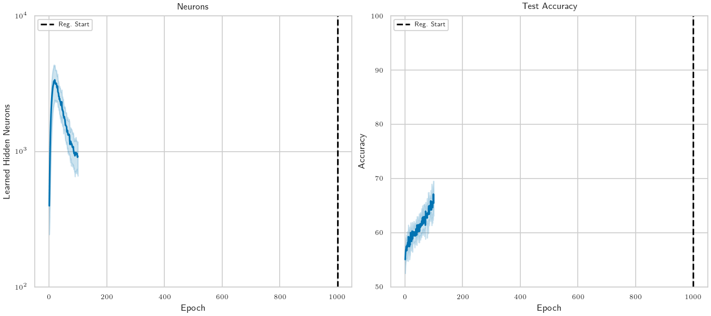

# Adaptive Width Neural Networks

Train neural networks that learn not only weights, but also how wide each layer should be.



This repository contains the official code for **Adaptive Width Neural Networks (AWN)** across multiple model families (MLP, CNN/ResNet, RNN, Transformer, and Deep Graph Networks), implemented on top of [MLWiz](https://github.com/diningphil/mlwiz).

## What this project does

AWN learns a distribution over each layer's width and dynamically adapts architecture capacity during training. In practice, this repo provides:

- Fixed-width baselines (`model.MLP`, `model.ResNet20`, `model.RNN`, `model.Transformer`, `model.DGN`)
- Adaptive-width models (`model.AWN`) with dynamic backbones (`dynamic_architecture.DynamicMLP`, `dynamic_architecture.DynamicResNet20`, `dynamic_architecture.DynamicRNN`, `dynamic_architecture.DynamicDGN`, `dynamic_transformer.DynamicTransformer`)

## Setup

```bash
python -m venv .venv
# Windows PowerShell
# .venv\Scripts\Activate.ps1
# Linux/macOS
source .venv/bin/activate
pip install --upgrade pip
pip install -r requirements.txt
```

## Reproduce experiments

All runs are config-driven through MLWiz.

### 1. Prepare data and splits

Run once per dataset you want to use:

```bash
mlwiz-data --config-file DATA_CONFIGS/config_spiralHard.yml
mlwiz-data --config-file DATA_CONFIGS/config_CIFAR10.yml
mlwiz-data --config-file DATA_CONFIGS/config_CIFAR100.yml
mlwiz-data --config-file DATA_CONFIGS/config_PermutedMNIST.yml
mlwiz-data --config-file DATA_CONFIGS/config_Multi30K.yml
mlwiz-data --config-file DATA_CONFIGS/config_REDDIT-BINARY.yml
```

We already provide precomputed data splits in the `DATA_SPLITS` folder.

### 2. Run AWN vs fixed baselines

`--debug` runs sequentially (single process). Without `--debug`, MLWiz uses Ray for parallel execution.

```bash
# MLP (SpiralHard)
mlwiz-exp --config-file EXP_CONFIGS/GRID/MLP/SpiralHard/mlp_awn.yml --debug
mlwiz-exp --config-file EXP_CONFIGS/GRID/MLP/SpiralHard/mlp_fixed.yml --debug

# CNN (CIFAR-10)
mlwiz-exp --config-file EXP_CONFIGS/GRID/CNN/CIFAR10/resnet20_awn.yml --debug
mlwiz-exp --config-file EXP_CONFIGS/GRID/CNN/CIFAR10/resnet20_fixed.yml --debug

# RNN (PermutedMNIST)
mlwiz-exp --config-file EXP_CONFIGS/GRID/RNN/rnn_awn.yml --debug
mlwiz-exp --config-file EXP_CONFIGS/GRID/RNN/rnn_fixed.yml --debug

# Transformer (Multi30K)
mlwiz-exp --config-file EXP_CONFIGS/GRID/TRANSFORMER/Multi30K/transformer_awn.yml --debug
mlwiz-exp --config-file EXP_CONFIGS/GRID/TRANSFORMER/Multi30K/transformer_fixed.yml --debug

# DGN (REDDIT-BINARY)
mlwiz-exp --config-file EXP_CONFIGS/GRID/DGN/REDDIT_BINARY/dgn_awn.yml --debug
mlwiz-exp --config-file EXP_CONFIGS/GRID/DGN/REDDIT_BINARY/dgn_fixed.yml --debug
```

### 3. Optional search baselines

```bash
# Local Search
mlwiz-exp --config-file EXP_CONFIGS/LOCAL_SEARCH/CNN/CIFAR10/resnet20_fixed.yml --debug

# Bayesian Optimization
mlwiz-exp --config-file EXP_CONFIGS/BO/CNN/CIFAR10/resnet20_fixed.yml --debug
```

## Where results are written

- Output folders are controlled by each experiment config via `result_folder` and `exp_name`.
- Example: `EXP_CONFIGS/GRID/MLP/SpiralHard/mlp_awn.yml` writes to `RESULTS/MLP/SpiralHard`.
- Seeds are set in configs (`seed: 42`) for reproducibility.

## Citing Us

Please cite and reference the paper:

```
@inproceedings{errica_awn_2026,
title={Adaptive Width Neural Networks},
author={Errica, Federico and Christiansen, Henrik and Zaverkin, Viktor and Niepert, Mathias and Alesiani, Francesco},
booktitle={Proceddings of the 14th International Conference on Learning Representations (ICLR)},
year={2026},
url={https://openreview.net/forum?id=p6Ek7Qg577}
}
```
## License

This code is released under the license in `LICENSE.txt` (noncommercial research use).
