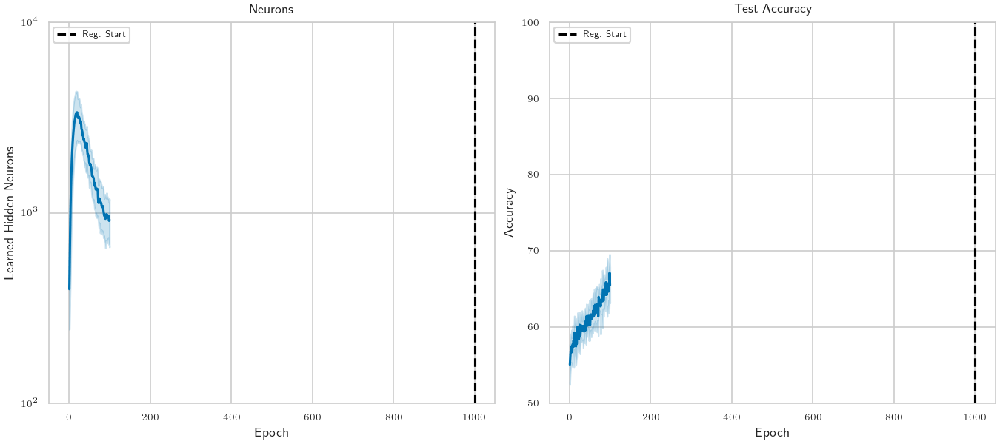

# Adaptive Width Neural Networks

Train neural networks that learn not only weights, but also how wide each layer should be.



This repository contains the official code for **Adaptive Width Neural Networks (AWN)** across multiple model families (MLP, CNN/ResNet, RNN, Transformer, and Deep Graph Networks), implemented on top of [MLWiz](https://github.com/diningphil/mlwiz).

## What this project does

AWN learns a distribution over each layer's width and dynamically adapts architecture capacity during training. In practice, this repo provides:

- Fixed-width baselines (`model.MLP`, `model.ResNet20`, `model.RNN`, `model.Transformer`, `model.DGN`)
- Adaptive-width models (`model.AWN`) with dynamic backbones (`dynamic_architecture.DynamicMLP`, `dynamic_architecture.DynamicResNet20`, `dynamic_architecture.DynamicRNN`, `dynamic_architecture.DynamicDGN`, `dynamic_transformer.DynamicTransformer`)

## Setup

Install [uv](https://docs.astral.sh/uv/getting-started/installation/), then run
from the repository root:

```bash
uv sync --locked
```

The project uses Python 3.12 by default (`.python-version`); uv downloads it if
needed. Dependencies are maintained in `pyproject.toml`, with exact versions in
`uv.lock`. `requirements.txt` is a generated compatibility export for pip users.
To regenerate it after updating the lockfile:

```bash
uv export --locked --no-hashes --no-annotate --no-emit-project -o requirements.txt
```

The environment uses MLWiz 1.7.8 and PyTorch >=2.5, as required by current MLWiz.
The original paper used PyTorch 2.0–2.4 and MLWiz 1.2.0; the upgraded environment
can produce different numerical results. The lockfile uses PyPI's PyTorch wheels;
GPU execution requires a driver compatible with the installed PyTorch build.
The Hugging Face dependencies stay on the existing `datasets` 3.x and
`transformers` 4.x API families.

## Reproduce experiments

All runs are config-driven through MLWiz. Experiment YAML files use the MLWiz
1.7 schema: `dataset`, `resources`, `reproducibility`, `data_loading`, and
`experiment` sections, plus `grid` or `random`. Random-search budgets live under
`random.budget`. Data preparation configs retain their `dataset`/`splitter` schema.
Telegram notifications are disabled by default; to enable them, set
`experiment.telegram_config_file` to your credentials file.

For single-machine runs, keep Ray workers in the synchronized uv environment
and repository working directory:

```bash
export RAY_ENABLE_UV_RUN_RUNTIME_ENV=0
```

Ray otherwise recreates a separate uv environment in each temporary runtime,
including for debug runs, which can consume several GB per invocation.
`.rayignore` excludes generated files when automatic working-directory packaging
is enabled. Multi-machine clusters need separately provisioned environments and
shared absolute data/result paths.

### 1. Prepare data and splits

Run once per dataset you want to use:

```bash
uv run mlwiz-data --config-file DATA_CONFIGS/config_spiralHard.yml
uv run mlwiz-data --config-file DATA_CONFIGS/config_CIFAR10.yml
uv run mlwiz-data --config-file DATA_CONFIGS/config_CIFAR100.yml
uv run mlwiz-data --config-file DATA_CONFIGS/config_PermutedMNIST.yml
uv run mlwiz-data --config-file DATA_CONFIGS/config_Multi30K.yml
uv run mlwiz-data --config-file DATA_CONFIGS/config_REDDIT-BINARY.yml
```

We already provide precomputed data splits in the `DATA_SPLITS` folder.

If `mlwiz-data` reports that zero-dimensional targets cannot be concatenated,
regenerate the affected cached synthetic dataset (`DoubleMoon`, `Spiral`, or
`SpiralHard`). New samples store each label as a one-element tensor; existing
processed files are loaded as stored.

### 2. Run AWN vs fixed baselines

`--debug` runs sequentially (single process). Without `--debug`, MLWiz uses Ray for parallel execution.

```bash
# MLP (SpiralHard)
uv run mlwiz-exp --config-file EXP_CONFIGS/GRID/MLP/SpiralHard/mlp_awn.yml --debug
uv run mlwiz-exp --config-file EXP_CONFIGS/GRID/MLP/SpiralHard/mlp_fixed.yml --debug

# CNN (CIFAR-10)
uv run mlwiz-exp --config-file EXP_CONFIGS/GRID/CNN/CIFAR10/resnet20_awn.yml --debug
uv run mlwiz-exp --config-file EXP_CONFIGS/GRID/CNN/CIFAR10/resnet20_fixed.yml --debug

# RNN (PermutedMNIST)
uv run mlwiz-exp --config-file EXP_CONFIGS/GRID/RNN/rnn_awn.yml --debug
uv run mlwiz-exp --config-file EXP_CONFIGS/GRID/RNN/rnn_fixed.yml --debug

# Transformer (Multi30K)
uv run mlwiz-exp --config-file EXP_CONFIGS/GRID/TRANSFORMER/Multi30K/transformer_awn.yml --debug
uv run mlwiz-exp --config-file EXP_CONFIGS/GRID/TRANSFORMER/Multi30K/transformer_fixed.yml --debug

# DGN (REDDIT-BINARY)
uv run mlwiz-exp --config-file EXP_CONFIGS/GRID/DGN/REDDIT_BINARY/dgn_awn.yml --debug
uv run mlwiz-exp --config-file EXP_CONFIGS/GRID/DGN/REDDIT_BINARY/dgn_fixed.yml --debug
```

### 3. Optional search baselines

```bash
# Local Search
uv run mlwiz-exp --config-file EXP_CONFIGS/LOCAL_SEARCH/CNN/CIFAR10/resnet20_fixed.yml --debug

# Bayesian Optimization
uv run mlwiz-exp --config-file EXP_CONFIGS/BO/CNN/CIFAR10/resnet20_fixed.yml --debug
```

## Where results are written

- Output folders are controlled by each experiment config via `experiment.result_folder` and `experiment.exp_name`.
- Example: `EXP_CONFIGS/GRID/MLP/SpiralHard/mlp_awn.yml` writes to `RESULTS/MLP/SpiralHard`.
- Seeds are set in configs (`reproducibility.seed: 42`) for reproducibility.

Graph splits now live directly under `DATA_SPLITS/NCI1` and
`DATA_SPLITS/REDDIT_BINARY`, matching the data-preparation output paths. The
unused `SigmoidDistribution` option was removed from the distribution study
because its implementation is absent from the repository.

## Citing Us

Please cite and reference the paper:

```
@inproceedings{errica_awn_2026,
title={Adaptive Width Neural Networks},
author={Errica, Federico and Christiansen, Henrik and Zaverkin, Viktor and Niepert, Mathias and Alesiani, Francesco},
booktitle={Proceddings of the 14th International Conference on Learning Representations (ICLR)},
year={2026},
url={https://openreview.net/forum?id=p6Ek7Qg577}
}
```
## License

This code is released under the license in `LICENSE.txt` (noncommercial research use).
